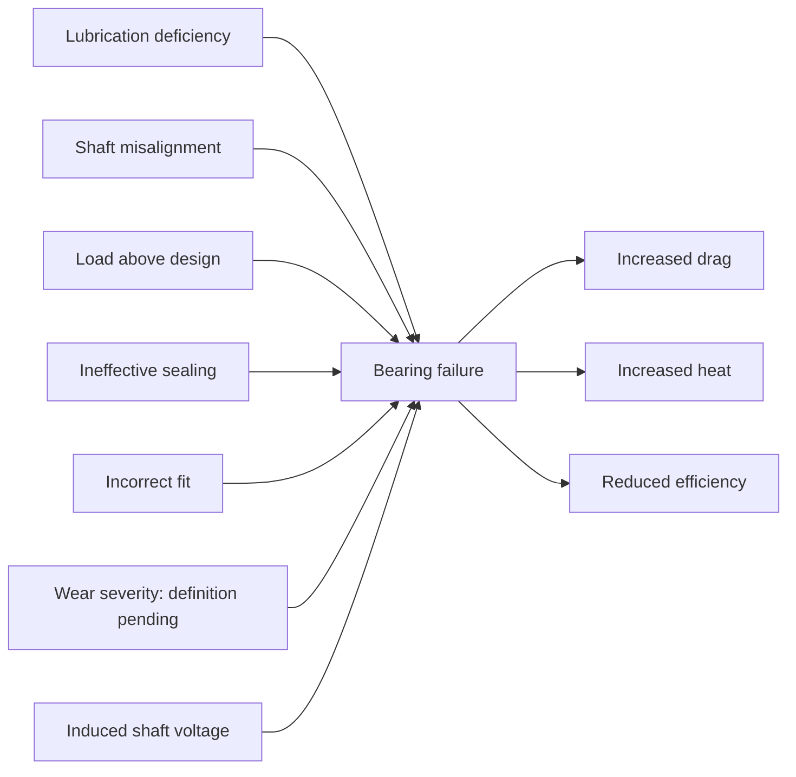

# Bayesian readiness audit — bearing mechanism

Status: ready for structure review; not ready for probability assignment.

## What was audited

The existing 62-concept, 47-statement ontology and all 138 excluded statement candidates were inspected for review status. Full stored source sections were read for bearing wear, shaft voltage, misalignment, excessive moisture, unbalanced load, and damaged bearings. This is a bounded source-text audit, not a complete PDF/corpus or engineering validation. Original ontology, extraction records and review decisions were preserved.

Exclusion inventory: 4 rejected, 2 uncertain, 132 unreviewed. See excluded_candidates.json for individual decisions and validation issues. Mechanical validity does not establish technical correctness.

## Why the graph is disconnected

| Finding | Evidence | Disposition |
|---|---|---|
| Section-scoped identity | ontology.py hashes document ID, section ID and label | Representation separation is confirmed; component count is not an independence test. |
| Bearing failure appears in Fluke and AC troubleshooting sections | AC source explicitly links unbalanced load to bearing failure | Candidate shared BN variable, pending equipment/context alignment. Do not equate unbalanced load with excessive load. |
| Misalignment versus shaft misalignment | Fluke section 7 defines drive-shaft/coupling misalignment; section 10 lists shaft misalignment as a bearing-failure cause | Strong terminology alignment candidate; retain source-specific evidence and resolve subtype scope. |
| Excessive moisture versus lubrication deficiency | EPRI describes loss of lubrication capability specifically in bearing oil systems | Possible upstream link requiring oil-system applicability; not an exact synonym merge with all inadequate lubrication. |
| Damaged bearing versus failed bearing | Timken says some damaged bearings can return to service after refurbishment | Do not automatically merge damage and functional failure. |
| Motor failure consequence missing | Two extracted bearing-failure → motor-failure candidates remain unreviewed | Review backlog, not an extraction omission. Deduplicate and preserve the cascade/acceleration wording. |
| Shaft-voltage mechanism missing | Section 13 contains flashover, race damage and friction relationships; candidates remain unreviewed and some quotes fail validation | Repair quotation/condition defects in new candidates and adjudicate the chain before adding it. |

The audited evidence establishes representation and review gaps. It does not establish that all components should connect or that the remaining mechanisms are independent.

## Bearing candidate triage

| Section | Candidate | Relationship | Review | Mechanical issues |
|---|---|---|---|
| fault-07 | ATOM_af5a969dc8f1ae71c06a2eec | motor drive shaft → CAUSES → Misalignment | rejected | none |
| fault-07 | ATOM_05c4b60c3973d77a67787e76 | coupling component → CAUSES → Misalignment | rejected | none |
| fault-07 | ATOM_710b139589fe7a643233f5a0 | Flexible coupling → HAS_FUNCTION → protects the coupling from misalignment | unreviewed | Quote is not an exact nonempty cleaned-text substring |
| fault-07 | ATOM_21f907bf2521581aa2b5eaa6 | Misaligned shaft → CAUSES → damaging cyclical forces | unreviewed | none |
| fault-07 | ATOM_7a7353246cec1b804d7ac1c7 | damaging cyclical forces → LEADS_TO → excess wear on the motor | unreviewed | none |
| fault-07 | ATOM_6e315435d8a3fe95fb9d38e8 | damaging cyclical forces → LEADS_TO → increasing the apparent mechanical load | unreviewed | none |
| fault-07 | ATOM_689a623b987a750c915b2595 | Misalignment → CAUSES → vibration in the load | unreviewed | none |
| fault-07 | ATOM_d0d12616e0772dbd87256c1a | Misalignment → CAUSES → vibration in the motor drive shaft | unreviewed | none |
| fault-07 | ATOM_32eecf849adec80df9a00511 | Premature wear in mechanical drive components → LEADS_TO → premature failures | unreviewed | none |
| fault-07 | ATOM_2a1b558ef8bf01e74f7c3e91 | Misalignment → MITIGATED_BY → Fluke 830 Laser Shaft Alignment Tool | rejected | none |
| fault-10 | ATOM_c3872dfa4e86a786dae48a1c | bearing failure → CAUSES → motor failure | unreviewed | none |
| fault-10 | ATOM_8308e306b64cd75d49374c93 | bearing failure → CAUSES → motor failure | unreviewed | none |
| fault-10 | ATOM_126fb53d981a54b5e5513afe | bearing wear → CAUSES → mechanical failures | unreviewed | none |
| fault-10 | ATOM_18d6471281dba0ac567a7608 | bearing wear → DETECTED_BY → Fluke 810 Vibration Tester | unreviewed | none |
| fault-13 | ATOM_ed91b40129aa2d4097e1cc99 | motor shaft voltage → CAUSES → flashover currents to outer bearing | unreviewed | Quote is not an exact nonempty cleaned-text substring |
| fault-13 | ATOM_25928b85e6393e92cfe1b3a2 | flashover currents to outer bearing → CAUSES → pitting to bearing races | unreviewed | none |
| fault-13 | ATOM_685119ed653a3fef3f089253 | flashover currents to outer bearing → CAUSES → grooving to bearing races | unreviewed | none |
| fault-13 | ATOM_500d86304fb264d2244fdda8 | metal fragments mixing with grease → CAUSES → increased bearing friction | unreviewed | none |
| fault-13 | ATOM_39aa0a533e55eef7258234fd | increased bearing friction → LEADS_TO → bearing destruction | unreviewed | none |
| fault-13 | ATOM_264f02c043a1241f90ace6b6 | bearing failure → DETECTED_BY → measurement of shaft voltage and bearing current | unreviewed | none |
| fault-13 | ATOM_56433038f07e8268ca79563b | carbon brush probe attachment → HAS_FUNCTION → measure shaft voltage while motor is rotating | unreviewed | none |
| fault-13 | ATOM_af4920215d8a37737448242e | arcing across bearing surfaces → CAUSES → pitting | unreviewed | none |
| fault-13 | ATOM_a8efd1b20284574f0cec18ed | arcing across bearing surfaces → CAUSES → fluting | unreviewed | none |
| fault-13 | ATOM_6c2275e70cb1ffe20ae172a0 | pitting → LEADS_TO → excessive vibration | unreviewed | Quote is not an exact nonempty cleaned-text substring |
| fault-13 | ATOM_3883adfab75d0a29200e4530 | fluting → LEADS_TO → excessive vibration | unreviewed | Quote is not an exact nonempty cleaned-text substring |
| fault-13 | ATOM_d77bac25e96a5c9056840d2e | pitting → LEADS_TO → eventual bearing failure | unreviewed | Quote is not an exact nonempty cleaned-text substring |
| fault-13 | ATOM_ff98ef2b5c60f99baaeceb37 | fluting → LEADS_TO → eventual bearing failure | unreviewed | Quote is not an exact nonempty cleaned-text substring |

For section 13, the voltage-to-flashover claim must retain the condition that voltage exceeds grease insulating capability. The pronoun “This” before bearing destruction requires contextual review; do not silently reduce the whole damage process to friction alone. Diagnostic instruments are not probabilistic test-result variables until measurement outcomes and accuracy are defined.

## Proposed initial structure

bearing_structure.draft.json contains the existing section-10 evidence mapped to 11 provisional binary variables and 10 proposed dependencies, with source IDs and quotations. All probabilities and operational thresholds remain null. The JSON is a review artifact, not an executable inference model.

This topology is provisional: it implies independent root causes and conditionally independent symptoms given bearing failure. Neither assumption is validated. Investigate shared operating conditions, symptom dependencies and alternative causes before eliciting CPTs. Acyclicity alone is insufficient. Seven binary parents would give bearing failure 128 parent configurations; do not default to noisy-OR without validating its assumptions.

## Conditions for moving to probabilities

- Choose the equipment population, operating regime, diagnostic or predictive purpose, and observation time or prediction horizon.
- Define every state operationally, including thresholds for heat, drag, wear and failure. Unknown observations are missing evidence, not automatically an extra physical state.
- Adjudicate the relevant candidate omissions and proposed concept alignments; document intentional scope exclusions.
- Obtain domain review of dependencies, directions, common causes and independence assumptions.
- Identify operating records with appropriate denominators/exposure, or experts able to elicit priors and conditional probabilities for the defined population.
- Prepare validation cases and sensitivity checks for the later parameterized model.

The source’s 13% attribution of motor failures to bearings is not P(bearing failure), nor P(motor failure | bearing failure). The “more than 60%” statement has another denominator. Neither is entered as a CPT value.

Ready-to-proceed rule: begin probability elicitation for this bounded subsystem once the scope, states, dependencies and parameter sources above are resolved. Full ontology connectedness is not required. Calibration and predictive validation follow parameterization before practical use.

## Artifact checks

All 138 exported exclusions matched current candidates. All draft edges reference existing ontology statements and endpoints. The 11-node, 10-edge proposed structure is acyclic. These checks do not validate engineering claims.
